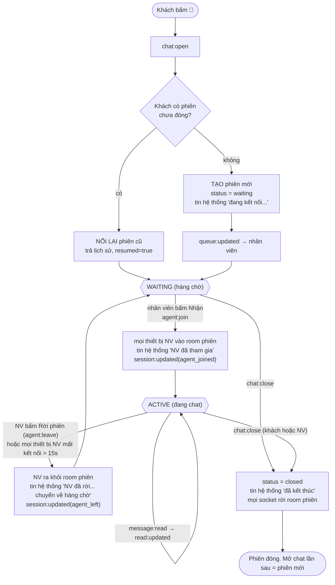

# Bài tập 7: Khung chat hỗ trợ khách hàng thời gian thực

NestJS 11 + Socket.IO 4. Mọi sự kiện được khai báo kiểu ở **một file duy nhất**, [`src/shared/contract.ts`](src/shared/contract.ts). Server và client cùng dùng file này, nên bảng sự kiện dưới đây và code luôn khớp nhau: lệch một trường là TypeScript báo lỗi.

```
src/shared/contract.ts       bảng sự kiện (kiểu dữ liệu từng trường)
src/shared/message-rules.ts  chặn bẫy dữ liệu (dùng chung client + server)
src/server/chat.gateway.ts   xử lý sự kiện, room
src/server/chat.store.ts     nơi lưu trạng thái phiên
src/server/typing.service.ts trạng thái "đang soạn tin"
public/customer.html         giao diện khách (nút chat nổi, thu nhỏ được)
public/agent.html            giao diện nhân viên (hàng chờ + nhiều phiên)
logs/chat-demo.log           log có mốc thời gian để chấm độ trễ
```

---

# PHẦN A: Phân tích và thiết kế

## A1. Phân tích I/O: bảng sự kiện

Kiểu dùng chung:

| Kiểu | Trường | Kiểu dữ liệu | Ý nghĩa |
|---|---|---|---|
| **ChatMessage** | `id` | string | server cấp, dạng `S-0001#5` |
| | `sessionId` | string | |
| | `seq` | number | thứ tự trong phiên, tăng từ 1 |
| | `senderRole` | `"customer" \| "agent" \| "system"` | |
| | `senderId` | string \| null | null với tin hệ thống |
| | `text` | string | đã chuẩn hoá, ≤ 2.000 ký tự |
| | `createdAt` | number | epoch ms, giờ server |
| | `clientMsgId` | string \| null | client tự sinh, dùng để **chống nhân đôi** |
| | `clientSentAt` | number \| null | lúc bấm gửi, dùng để **đo độ trễ** |
| **SessionView** | `id`, `customerId` | string | |
| | `agentId` | string \| null | null khi đang ở hàng chờ |
| | `status` | `"waiting" \| "active" \| "closed"` | |
| | `createdAt`, `lastSeq` | number | |
| | `readUpTo` | `{ customer: number; agent: number }` | seq lớn nhất mỗi bên **đã thực sự xem** |
| | `lastMessage` | `{ text; senderRole; createdAt } \| null` | xem trước ở hàng chờ |
| **Ack\<T\>** | | `{ ok: true, ...T } \| { ok: false; code: ErrorCode; error: string }` | `error` là câu thân thiện để hiện cho người dùng |

**Client → Server** (ack = server phản hồi qua callback):

| Sự kiện | Ai gửi | Dữ liệu gửi | Ack trả về | Khi nào |
|---|---|---|---|---|
| `chat:open` | khách | `{ sinceSeq?: number }` | `{ session: SessionView, messages: ChatMessage[], resumed: boolean }` | bấm mở chat; tự gửi lại khi nối lại mạng |
| `message:send` | cả hai | `{ sessionId: string, clientMsgId: string, text: string, sentAt?: number }` | `{ message: ChatMessage, duplicate: boolean }` hoặc lỗi `EMPTY` / `TOO_LONG` / `FORBIDDEN` / `SESSION_CLOSED` | bấm Gửi |
| `typing:start` | cả hai | `{ sessionId: string }` | (không) | gõ phím; tối đa 1 lần/giây |
| `typing:stop` | cả hai | `{ sessionId: string }` | (không) | sau **3 giây** không gõ |
| `message:read` | cả hai | `{ sessionId: string, upToSeq: number }` | (không) | khung chat **đang mở + tab đang hiện** |
| `chat:close` | cả hai | `{ sessionId: string }` | `{ session: SessionView }` | bấm Kết thúc |
| `agent:join` | nhân viên | `{ sessionId: string }` | `{ session, messages }` hoặc lỗi `TAKEN` | bấm "Nhận" ở hàng chờ |
| `agent:leave` | nhân viên | `{ sessionId: string }` | `{ session: SessionView }` | bấm "Rời phiên" |

**Server → Client:**

| Sự kiện | Gửi tới | Dữ liệu | Khi nào |
|---|---|---|---|
| `message:new` | room `session:<id>` | `ChatMessage` | có tin mới (kể cả tin hệ thống) |
| `typing:updated` | room `session:<id>` | `{ sessionId: string, role: Role, isTyping: boolean }` | trạng thái gõ **đổi** (không gửi theo từng phím) |
| `read:updated` | room `session:<id>` | `{ sessionId: string, readerRole: Role, upToSeq: number, readAt: number }` | một bên xem thêm tin |
| `session:updated` | room `session:<id>` | `{ session: SessionView, reason: "agent_joined" \| "agent_left" \| "agent_disconnected" \| "closed" }` | phiên đổi trạng thái |
| `queue:updated` | room `agents` | `{ sessions: SessionView[] }` | hàng chờ hoặc danh sách phiên mở thay đổi |

Tổng cộng **8 sự kiện lên server và 5 sự kiện xuống client**. Không có sự kiện riêng cho "tải lịch sử", vì `chat:open` / `agent:join` trả lịch sử luôn trong ack.

## A2. Đề xuất giải pháp

**Room được dùng thế nào?**

| Room | Thành viên | Dùng để |
|---|---|---|
| `user:<role>:<id>` | mọi thiết bị của **một người** | `server.in(user:agent:an).socketsJoin(session:S-1)` kéo cùng lúc mọi thiết bị của nhân viên vào/ra phiên |
| `session:<id>` | mọi thiết bị của khách + nhân viên trong phiên | tin nhắn, đang soạn, đã xem, đổi trạng thái: **phát 1 lần**, mỗi socket nhận đúng 1 bản |
| `agents` | mọi nhân viên online | hàng chờ |

**Trạng thái phiên lưu ở đâu?** Ở **server** (`ChatStore`), nguồn sự thật duy nhất. Client không giữ gì lâu dài: mở tab hay nối lại mạng thì lấy lịch sử từ ack của `chat:open`. Bản demo lưu trong RAM; bản thật dùng bảng `sessions` và `messages` trong DB (ràng buộc `UNIQUE(session_id, sender_id, client_msg_id)`), cộng Redis adapter nếu chạy nhiều server.

**Nhiều thiết bị của cùng một người:**
1. Danh tính lấy từ **token**, không lấy từ socket. Hai tab cùng là `customer:khach-01`, nên `chat:open` trả về **cùng phiên** (`resumed: true`).
2. Cả hai tab ở chung room phiên. Server phát `message:new` **một lần** vào room, nên mỗi tab nhận đúng một bản; tab gửi thấy tin đồng bộ sang tab kia.
3. Tab gửi đã hiện tin "đang gửi…" từ trước. Khi `message:new` về, tab đó **thay** bản đang gửi bằng tin thật, nhận ra nhờ `clientMsgId`, chứ không thêm dòng mới.
4. Client **hiển thị theo `id`** (`Map<id, message>`): cùng một tin đến từ ack, từ sự kiện và từ lịch sử vẫn chỉ hiện một dòng.
5. Mạng chập chờn làm mất ack, client gửi lại **cùng `clientMsgId`**. Server thấy trùng thì trả lại tin cũ (`duplicate: true`) và **không phát lại**.

**"Đang soạn tin" 3 giây:** chỉ client biết khi nào phím được gõ, nên client quyết định mốc 3 giây (debounce). Server chỉ phát khi trạng thái **đổi**, và giữ thêm một lưới an toàn 4s (`typingTtlMs`) phòng client chết giữa chừng. Gửi tin, rời phiên hoặc đóng tab đều tắt ngay.

**"Đã xem":** *nhận* được tin chưa phải là *xem*. Client chỉ gửi `message:read` khi khung chat đang mở **và** `document.visibilityState === "visible"`. Thu nhỏ khung chat, chuyển tab hoặc nhân viên đang mở phiên khác thì không tính là đã xem.

## A3. Vòng đời một phiên chat



Các bước tuần tự:
1. Khách bấm nút chat, client gửi `chat:open`.
2. Server tìm phiên chưa đóng của khách. Có thì **nối lại**; không thì **tạo mới** (`waiting`), thêm tin chào và báo `queue:updated` cho nhân viên.
3. Socket của khách vào room `session:<id>`, nhận lịch sử qua ack. Thiết bị thứ hai lặp lại bước 1–3 và vào cùng phiên.
4. Nhân viên bấm "Nhận" (`agent:join`). Nếu phiên đã có người nhận thì báo lỗi `TAKEN`. Nếu chưa, **mọi thiết bị** của nhân viên vào room, phiên chuyển `active`, khách nhận `session:updated` và tin hệ thống.
5. Chat:
   - Gõ phím thì gửi `typing:start`, bên kia hiện "đang soạn…"; 3s không gõ thì gửi `typing:stop`.
   - Bấm gửi thì client kiểm tra trước, rồi server kiểm tra lại, lưu với `seq`, và phát `message:new` vào room.
   - Bên kia mở khung chat thì gửi `message:read`, người gửi thấy "✓✓ đã xem".
6. Trạng thái trung gian:
   - Nhân viên **rời phiên**, hoặc **mất kết nối mọi thiết bị quá 15s**: phiên về `waiting`, khách nhận thông báo, nhân viên khác nhận tiếp với đầy đủ lịch sử.
   - Nhân viên nối lại **trong** 15s: tự vào lại room, khách không bị gián đoạn.
   - Khách mất mạng: phiên vẫn mở; khi nối lại, client gửi `chat:open` với `sinceSeq` để lấy các tin bị lỡ.
7. Một bên bấm Kết thúc (`chat:close`): phiên `closed`, mọi socket rời room. Mở chat lần sau sẽ tạo phiên mới.

---

# PHẦN B: Triển khai và chống lỗi

## Đoạn code chặn từng bẫy dữ liệu

**Bẫy 1: tin rỗng hoặc chỉ có khoảng trắng.** Chặn ở `src/shared/message-rules.ts`, chạy ở cả trình duyệt lẫn server:
```ts
const INVISIBLE = /[​-‍⁠]/g;          // zero-width space... "khoảng trắng tàng hình"
const text = raw.replace(/\r\n?/g, "\n").replace(INVISIBLE, "").trim();
if (text.length === 0) {
  return { ok: false, code: "EMPTY", error: "Bạn chưa nhập nội dung. Hãy gõ vài chữ trước khi gửi nhé!" };
}
```

**Bẫy 2: tin dài 20.000 ký tự.**
```ts
if (raw.length > max * 4) return tooLong(raw.length, max);  // chuỗi khổng lồ: báo ngay, không duyệt từng ký tự
const length = [...text].length;                             // đếm theo ký tự thật: 😀 = 1
if (length > max) return tooLong(length, max);
// → "Tin nhắn dài 20.000 ký tự, vượt giới hạn 2.000 ký tự. Bạn vui lòng rút gọn hoặc chia thành nhiều tin nhỏ hơn nhé."
```
- **Trình duyệt**: bộ đếm `20.000/2.000` chuyển đỏ, câu báo lỗi hiện dưới ô nhập, nội dung **vẫn giữ** để khách sửa (không tự cắt mất chữ).
- **Server**: kiểm tra lại, vì client có thể bị sửa (TC10, TC11 gửi thẳng lên server bỏ qua kiểm tra ở client).
- **Tầng vận chuyển**: `maxHttpBufferSize: 100_000`. Gói vượt mức này bị Socket.IO **ngắt kết nối** ngay, nên tôi đặt rộng hơn 20.000 ký tự tiếng Việt (~60KB). Nhờ vậy tin 20.000 ký tự vẫn tới được tầng ứng dụng và nhận câu trả lời thân thiện, còn gói vài MB (tấn công) thì bị chặn cứng.

**Bẫy 3: 2 thiết bị cùng lúc.** Server, `chat.store.ts`:
```ts
const key = `${s.id}|${sender.role}:${sender.id}|${clientMsgId}`;
const existing = this.byClientMsgId.get(key);
if (existing) return { message: existing, duplicate: true };   // gửi lại → trả tin cũ, không phát lại
```
Client, `chat-common.js` / `chat-client.ts`:
```js
if (messages.has(m.id)) return;                 // hiển thị theo id → không bao giờ 2 dòng cho 1 tin
messages.set(m.id, m);
if (m.clientMsgId && pending.delete(m.clientMsgId)) return;  // thay bản "đang gửi…" bằng tin thật
```

**Bẫy phụ**: nội dung người dùng chỉ được gán qua `textContent`, không bao giờ qua `innerHTML`, để chống XSS. Người ngoài phiên gửi tin vào phiên thì nhận lỗi `FORBIDDEN` (TC4).

## Kết quả đo (`logs/chat-demo.log`)

```
nhan vien thay 'dang soan' sau 1ms ke tu phim dau; tu tat sau 3017ms ke tu phim cuoi
<- nhan S-0001#3 tu customer:khach-01: "Chao shop, don ORD-1024..." | tre 2ms
<- nhan S-0001#6 ... | tre 2ms (dong bo tu thiet bi khac cua minh)
sau 1 giay ma nhan vien chua mo khung chat: CHUA XEM (dung)
do tre 21 lan nhan tin: min 1ms, trung binh 4ms, max 9ms -> DAT (< 1 giay)
laptop: 12 tin, trung lap 0 | dien thoai: 12 tin, trung lap 0
laptop va dien thoai hien GIONG HET nhau (cung id, cung thu tu): DUNG
```
Độ trễ được tính bằng `thời điểm nhận − clientSentAt`, tức từ lúc người gửi bấm Gửi tới lúc bên kia nhận.

## Chạy và kiểm thử

```bash
npm install
npm test        # 12 test e2e (dùng đúng 3s cho "đang soạn tin")
npm run demo    # kịch bản đầy đủ → logs/chat-demo.log
npm run server  # http://localhost:4000
```
- Khách: `http://localhost:4000/customer.html?user=khach-01` (mở 2 tab để giả lập 2 thiết bị)
- Nhân viên: `http://localhost:4000/agent.html?user=an` và `?user=binh`

## Giới hạn đã biết
- Dữ liệu lưu trong RAM của một server. Bản thật cần DB và Redis adapter.
- Token chỉ là giả lập (`customer:<id>`, `agent:<id>`); thực tế phải dùng JWT.
- Chưa giới hạn tần suất gửi tin (chống spam), chưa tự đóng phiên khách bỏ đi lâu.
