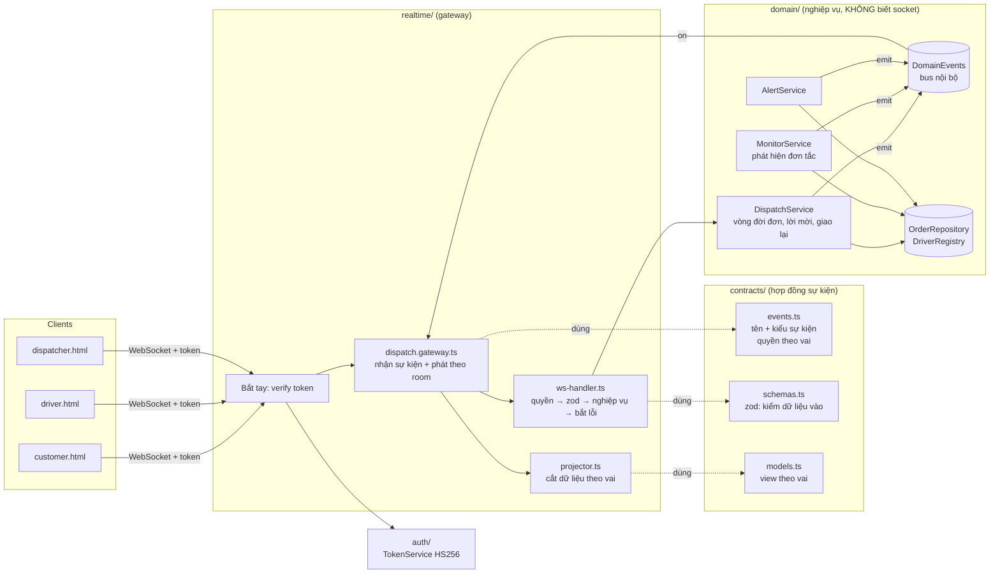

# Bài tập 9: Trung tâm điều phối giao hàng thời gian thực

NestJS 11 + Socket.IO 4 + zod. Ba vai **khách hàng, tài xế, điều phối viên** dùng chung một server; **mỗi vai chỉ nhận đúng dữ liệu của mình**.

```bash
npm install
npm test               # 19 test e2e: xác thực, phạm vi dữ liệu, nghiệp vụ, chịu lỗi, rò rỉ tài nguyên
npm run demo           # 6 vai chạy đồng thời → logs/demo.log
npm run server:demo    # server cho demo tay (ngưỡng ngắn), mở http://localhost:4000/
```

---

## 1. Bản đặc tả: thu hẹp yêu cầu mở

> *"Tôi muốn nhìn một màn hình là biết **đơn nào đang tắc ở đâu**, **tài xế nào đang rảnh**, và **can thiệp được ngay** khi cần."*

| # | Tình huống cụ thể | Đến từ câu nào | Vì sao chọn |
|---|---|---|---|
| T1 | **Đơn tắc**: đơn ở quá lâu trong một giai đoạn (chờ tài xế > 3 phút, tài xế nhận mà chưa lấy hàng > 15 phút, đang giao > 45 phút) thì báo động đỏ cho điều phối | "đơn nào đang **tắc** ở **đâu**" | "Tắc" phải đo được thì máy mới tự phát hiện, nên tôi định nghĩa bằng **ngưỡng thời gian theo từng giai đoạn**: cho biết tắc *ở đâu* trong vòng đời (chưa có tài xế, tài xế chưa tới, đang trên đường). |
| T2 | **Tài xế rảnh**: bảng và bản đồ tài xế với 3 trạng thái kết nối (online/lost/offline) × ca × việc (rảnh/đang được mời/đang giao) | "tài xế nào đang **rảnh**" | "Rảnh" = đang kết nối + trong ca + không có việc. Phải tách "mất kết nối" khỏi "nghỉ", nếu không điều phối sẽ giao nhầm đơn cho người không liên lạc được. |
| T3 | **Can thiệp**: giao (lại) đơn cho tài xế chỉ định, huỷ đơn, nhận xử lý cảnh báo (để điều phối viên khác biết đã có người lo) | "**can thiệp** được ngay" | Ba thao tác này giải quyết được mọi cảnh báo ở T1/T5. Giao tay vẫn cần tài xế bấm nhận, vì tài xế có thể đang không nhận được đơn. |
| T4 | **Tự động giao đơn**: mời tài xế rảnh gần điểm lấy hàng nhất; không trả lời trong 30s hoặc từ chối thì mời người kế tiếp | (ngầm) | Nếu không có, điều phối phải giao tay từng đơn. Khi có, màn hình chỉ cần chú ý **ngoại lệ**, đúng ý "nhìn là biết". |
| T5 | **Tài xế mất kết nối giữa đường**: lời mời đang chờ chuyển ngay người khác; đơn đang giao thì sau 20s ân hạn báo điều phối; tài xế quay lại thì cảnh báo tự đóng | "can thiệp **ngay khi cần**" | Đây là sự cố thật hay gặp nhất của app tài xế (bài 6). Nếu không xử lý, đơn bị "treo" âm thầm. |
| T6 | **Khách theo dõi đơn của mình**: trạng thái + vị trí tài xế **chỉ khi tài xế đang thực hiện đơn của chính khách đó** | ràng buộc 3 nhóm người dùng | Khách là nhóm thứ ba bắt buộc. Vị trí tài xế là dữ liệu nhạy cảm nhất, là phép thử tốt nhất cho việc **chia phạm vi**. |

**Cố ý chưa làm** (giới hạn phạm vi): tối ưu lộ trình, ghép nhiều đơn cho một tài xế, tính phí, chat; lưu trữ bền vững (đang dùng RAM).

---

## 2. Kiến trúc

### Sơ đồ module (Clean Code: 3 tầng tách biệt)



| Thư mục | Trách nhiệm | Không được làm |
|---|---|---|
| `src/contracts/` | Định nghĩa sự kiện, kiểu dữ liệu, schema kiểm tra, quyền theo vai | chứa logic |
| `src/domain/` | Quy tắc nghiệp vụ, trạng thái, bộ hẹn giờ; phát `DomainEvents` | import socket.io |
| `src/realtime/` | Xác thực bắt tay, nhận và phát sự kiện, **quyết định ai nhận gì** (projector + room) | chứa quy tắc nghiệp vụ |
| `src/auth/` | Ký/kiểm token, danh bạ user demo | |

### Luồng dữ liệu
1. Client gửi sự kiện (ví dụ `offer:respond`).
2. `ws-handler` kiểm theo thứ tự: **vai được phép?** → **dữ liệu hợp lệ (zod)?** → gọi `DispatchService` → mọi ngoại lệ đều đổi thành ack lỗi.
3. Nghiệp vụ đổi trạng thái rồi phát `DomainEvents` (`order.changed`, `offer.opened`, …).
4. Gateway nghe `DomainEvents`. Với mỗi sự kiện, **projector** tạo "lát cắt" cho từng vai và chỉ phát vào đúng room.

**Room:**
- `user:<id>`: mọi thiết bị của một người.
- `role:dispatcher`: các điều phối viên.

**Không có room "tất cả"**: không sự kiện nào được phát rộng cho mọi người.

---

## 3. Bảng hợp đồng sự kiện (khớp `src/contracts/events.ts`)

### Client → Server (8 sự kiện, đều qua kiểm quyền + zod)

| Sự kiện | Vai được gửi | Dữ liệu (kiểu) | Ack trả về |
|---|---|---|---|
| `order:place` | khách | `{ pickup: {lat: number, lng: number, address: string}, dropoff: Place }` | `{ order: CustomerOrderView }` |
| `driver:shift` | tài xế | `{ onShift: boolean }` | `{ driver: DriverView }` |
| `driver:location` | tài xế | `{ lat: number, lng: number }`; tối đa 1 lần/giây, quá thì bỏ | `{ accepted: boolean }` (có thể không chờ ack) |
| `offer:respond` | tài xế | `{ orderId: string, accept: boolean }` | `{ order: DriverOrderView \| null }` |
| `order:progress` | tài xế | `{ orderId: string, status: "picked_up" \| "delivered" }` | `{ order: DriverOrderView }` |
| `dispatch:assign` | điều phối | `{ orderId: string, driverId: string }` | `{ order: DispatcherOrderView }` |
| `dispatch:cancel` | điều phối | `{ orderId: string, reason: string(3..200) }` | `{ order: DispatcherOrderView }` |
| `alert:ack` | điều phối | `{ alertId: string }` | `{ alert: Alert }` |

Mọi ack lỗi có dạng `{ ok: false, code: "INVALID" | "FORBIDDEN" | "NOT_FOUND" | "CONFLICT" | "DRIVER_UNAVAILABLE" | "INTERNAL", error: string }`.

### Server → Client (8 sự kiện)

| Sự kiện | Ai được nhận | Dữ liệu | Khi nào |
|---|---|---|---|
| `session:ready` | mỗi socket, ngay sau bắt tay | `{ user, snapshot }`; snapshot **theo vai**: khách = đơn của mình; tài xế = trạng thái + đơn/lời mời hiện tại; điều phối = mọi đơn, tài xế, cảnh báo | kết nối / nối lại |
| `order:updated` | **khách sở hữu** (`CustomerOrderView`), **tài xế đang thực hiện** (`DriverOrderView`), **điều phối** (`DispatcherOrderView`) | `{ order }`, mỗi người một lát cắt khác nhau | đơn đổi trạng thái |
| `offer:new` | **chỉ tài xế được mời** | `{ offer: { orderId, pickup, dropoff, distanceKm, expiresAt, byDispatcher } }` | tự động hoặc điều phối giao |
| `offer:closed` | **chỉ tài xế đó** | `{ orderId, reason: accepted\|rejected\|expired\|revoked\|driver_lost\|cancelled }` | lời mời / phân công kết thúc |
| `courier:location` | **chỉ khách có đơn mà tài xế này đang thực hiện** | `{ orderId, lat, lng, at }` | tài xế gửi vị trí khi đơn ở `assigned` / `picked_up` |
| `driver:updated` | **chỉ điều phối** | `{ driver: DriverView }` | kết nối / ca / việc / vị trí đổi |
| `alert:raised` | **chỉ điều phối** | `{ alert: { id, kind: order_stuck\|driver_lost, orderId, driverId, message, … } }` | đơn tắc / tài xế mất kết nối quá ân hạn |
| `alert:updated` | **chỉ điều phối** | `{ alertId, status: acknowledged\|resolved, handledBy }` | có người nhận xử lý / sự cố tự hết |

### Lát cắt dữ liệu theo vai (`projector.ts`)

| Trường | Điều phối | Khách | Tài xế |
|---|---|---|---|
| SĐT khách | đầy đủ | (của mình) | **che**: `091****678` |
| Ai đã từ chối, lịch sử điều phối | ✅ | ❌ | ❌ |
| Trạng thái `offered` ("đang mời tài xế") | ✅ | hiện là `pending` | qua `offer:new` |
| Tên + xe tài xế | ✅ | chỉ khi tài xế **đã nhận** | — |
| Vị trí tài xế | mọi tài xế | chỉ tài xế **đang làm đơn của mình** | của mình |
| Cờ "đơn tắc", cảnh báo | ✅ | ❌ | ❌ |

---

## 4. Xác thực, chịu lỗi, dọn tài nguyên

- **Bắt tay**: `server.use()` kiểm token **trước** khi có kết nối.
  - Thiếu token → `AUTH_REQUIRED`; sai chữ ký hoặc giả mạo → `AUTH_INVALID`; hết hạn → `AUTH_EXPIRED`.
  - Socket bị từ chối **không bao giờ** vào room nào.
  - Token chữ ký HS256, so sánh bằng `timingSafeEqual`.
  - Token hết hạn giữa phiên → server tự ngắt kết nối.
  - API `/debug/resources` cũng yêu cầu Bearer token của điều phối viên.
- **Không crash**:
  - Mỗi handler đi qua `runHandler`: sai vai → `FORBIDDEN`; dữ liệu rác → `INVALID`; lỗi nghiệp vụ → mã lỗi rõ ràng; lỗi bất ngờ → `INTERNAL` + ghi log.
  - Listener `DomainEvents` lỗi không làm hỏng luồng nghiệp vụ.
  - Gói tin > 16KB thì chỉ socket đó bị ngắt.
- **Client mất kết nối đột ngột** (RST, đóng tab, chết im lặng):
  - Heartbeat 10s + 5s phát hiện kết nối chết im lặng.
  - Khi `disconnect`: xoá timer hết hạn token, xoá socket khỏi tài xế; lời mời đang chờ chuyển ngay người khác.
  - Timer ân hạn tự dọn khi hết hạn hoặc khi tài xế quay lại.
  - Mọi timer nằm trong Map nên **đếm được**: `/debug/resources` → `sockets, rooms, sessionTimers, offerTimers, graceTimers, driverSockets` đều về **0** (test R5, R6, demo bước 9).

---

## 5. Test case

### Tự động (`npm test`, 19 test)

| Nhóm | Test | Chứng minh |
|---|---|---|
| Xác thực | A1–A4 | không token / giả mạo / hết hạn bị từ chối tại bắt tay; API debug cần token điều phối |
| Phạm vi | S1–S5 | khách chỉ thấy đơn mình; lời mời chỉ tới đúng tài xế; vị trí chỉ tới đúng khách và dừng khi giao xong; lát cắt ẩn dữ liệu nội bộ, che SĐT; vượt quyền thì `FORBIDDEN` |
| Nghiệp vụ | B1–B4 | vòng đời đầy đủ; lời mời hết hạn chuyển người kế; đơn tắc → cảnh báo → giao tay → cảnh báo tự đóng; huỷ đơn, nhận xử lý cảnh báo giữa 2 điều phối viên |
| Chịu lỗi | R1–R6 | dữ liệu rác; gói quá lớn; tài xế rớt khi đang được mời; tài xế rớt khi đang giao rồi quay lại; 30 client rớt cùng lúc → tài nguyên về 0; client chết im lặng |

### Demo tay (3 vai song song)
```bash
npm run server:demo      # ngưỡng ngắn: lời mời 15s, ân hạn 10s, đơn tắc sau 30s
```
Mở `http://localhost:4000/`, bấm "Mở tab" cho: **Hà (điều phối)**, **Hùng**, **Tuấn** (tài xế), **Chị Lan**, **Anh Minh** (khách). Xếp các tab cạnh nhau.

| # | Kiểm tra | Thao tác | Kết quả đúng |
|---|---|---|---|
| M1 | Không token bị từ chối | trang chủ: **Kết nối không token** / **token giả** | `AUTH_REQUIRED` / `AUTH_INVALID` |
| M2 | Tài xế rảnh | Hùng, Tuấn bấm **Vào ca** | Điều phối: 2 tài xế "online · trong ca · idle", chấm xanh trên bản đồ |
| M3 | Tự động giao đơn gần nhất | Lan **Đặt đơn** (lấy tại Hồ Gươm) | Chỉ tab Hùng hiện popup đơn mới (đếm ngược); tab Tuấn không có gì |
| M4 | Khách theo dõi tài xế | Hùng **Nhận đơn** | Lan thấy "Tài xế đang tới lấy · Hùng · Wave…", bản đồ có 🛵 di chuyển; **Minh không nhận sự kiện nào** (xem ô "Sự kiện tôi nhận được") |
| M5 | Phạm vi dữ liệu | so sánh ô "Sự kiện tôi nhận được" giữa các tab | Khách: không có `driver:updated` / `alert` / `offer`; tài xế: không có `driver:updated` / `alert`; điều phối: thấy hết |
| M6 | Lời mời hết hạn | Minh đặt đơn → Tuấn được mời, **không bấm gì** 15s | Popup Tuấn biến mất (`offer:closed expired`); điều phối thấy "Đã từ chối: d-tuan" |
| M7 | **Đơn tắc** | để đơn của Minh chờ > 30s (không ai rảnh) | Điều phối: dòng đơn **đỏ + TẮC**, cảnh báo "⏳ Đơn tắc" |
| M8 | **Can thiệp** | điều phối bấm **Tôi xử lý**; ở dòng đơn của Minh chọn **Tuấn** → **Giao** (Tuấn đã lỡ lời mời nên hệ thống tự động không mời lại, chỉ điều phối mới giao được) | Tab điều phối khác (`?user=op-nam`) thấy "acknowledged bởi op-ha"; Tuấn nhận popup "(điều phối viên giao)"; Tuấn **Nhận đơn** thì cảnh báo **resolved**, dòng hết đỏ |
| M9 | Huỷ đơn | điều phối **Huỷ** một đơn | Khách thấy "Đã huỷ"; tài xế đang được mời thấy popup đóng |
| M10a | Rớt mạng **ngắn** | Hùng đang giao, bấm **💥 Ngắt đột ngột** | Điều phối thấy Hùng `lost` rồi `online` lại sau ~1s (client tự nối lại); **không** có cảnh báo nhờ ân hạn 10s; Hùng vẫn còn đơn |
| M10b | **Mất hẳn** giữa đường | Hùng đang giao, **đóng tab** Hùng | Điều phối: Hùng `lost` → sau 10s `offline` + cảnh báo "📵 Tài xế mất kết nối"; mở lại tab Hùng → cảnh báo tự đóng, đơn vẫn còn trên màn hình Hùng |
| M11 | Không rò rỉ | đóng tất cả tab trừ điều phối, xem ô "Tài nguyên server" | `driverSockets: 0`, `graceTimers: 0` (sau ân hạn), `offerTimers: 0`; `sockets`/`sessionTimers` = số tab còn mở |

### Kịch bản demo tự động
`npm run demo` chạy 6 vai đồng thời và một kẻ lạ không token, đi qua M1→M11. Cuối kịch bản, script tự kiểm phạm vi dữ liệu và tài nguyên (`logs/demo.log`, các dòng `KIEM-TRA`).

## Giới hạn
- Dữ liệu trong RAM, một server. Bản thật cần DB và Redis adapter (room hoạt động trên nhiều instance).
- Đăng nhập là bản demo (chọn user); bản thật cần mật khẩu/OTP. Cơ chế token và bắt tay giữ nguyên.
